

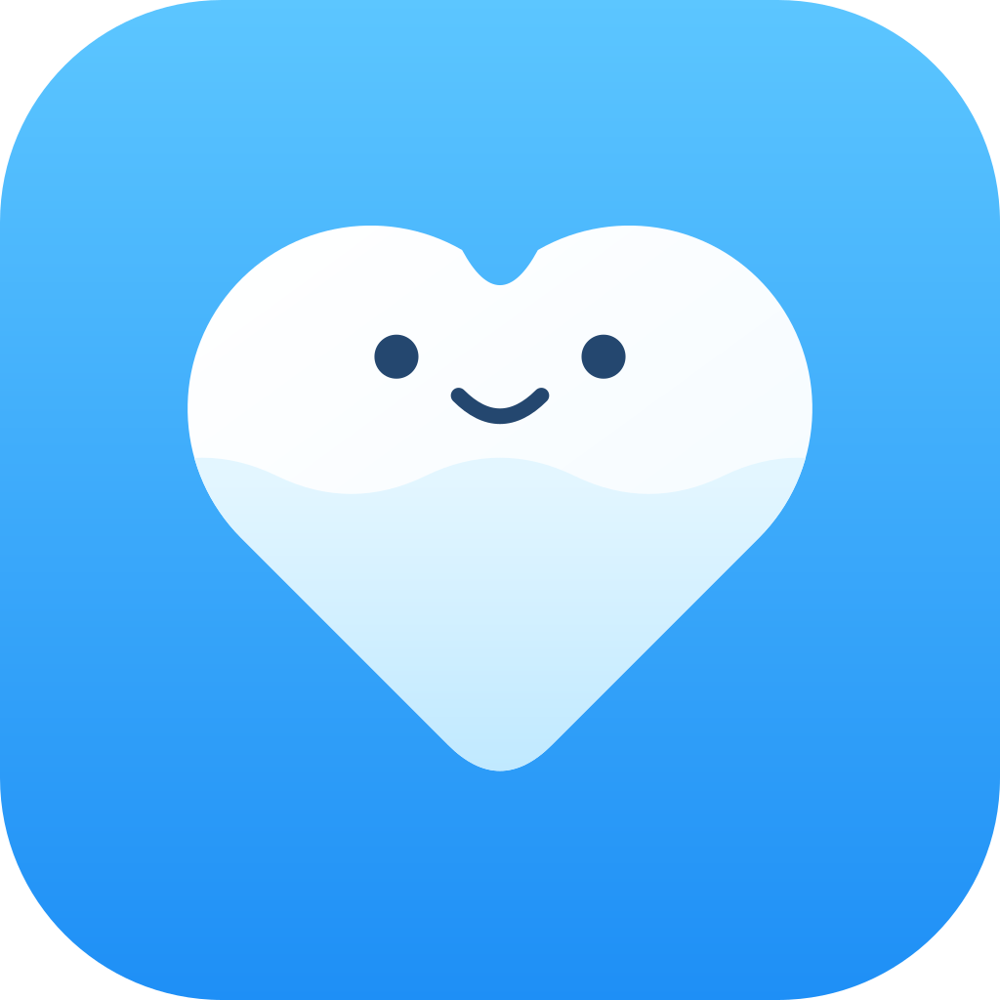

# HydraHeart

**Hydrate beautifully.**

*A little more hydration. A little more happiness. A healthier everyday.*

Meet HydraHeart, a free Android hydration companion designed to make drinking water a happier,
healthier habit. Track your drinks, check in on how you're feeling, and stay motivated with Hydra,
your little animated hydration companion.

No ads. No subscriptions. No paywalls. Just hydration, made a little more beautiful.

  <a href="docs/showcase-track.webp">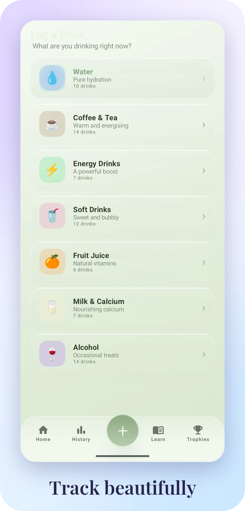</a>
  <a href="docs/showcase-hydra.webp"><picture>
    <source media="(prefers-reduced-motion: reduce)" srcset="docs/showcase-hydra-still.webp">
    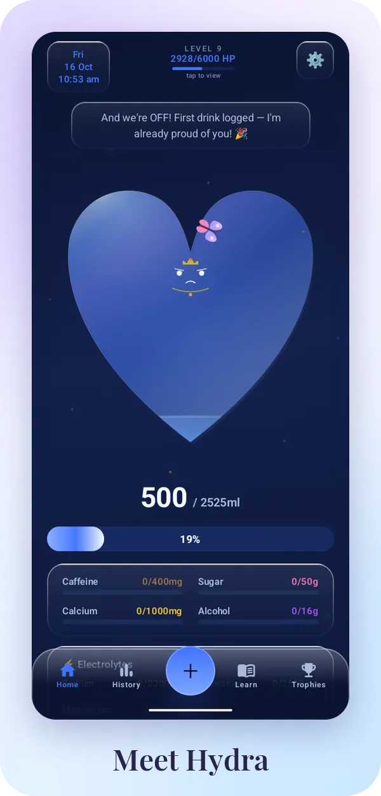
  </picture></a>
  <a href="docs/showcase-progress.webp">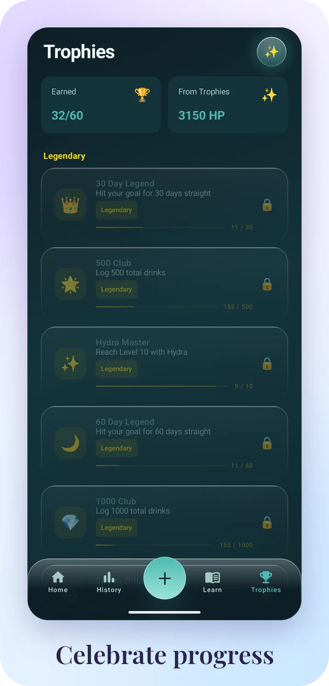</a>

<em>Mia logs a litre of water and Hydra cheers up. (Mia is made up for these screenshots. Tap any image to see it full size.)</em>

**Contents:** [Why it exists](#why-hydraheart-exists) · [Meet Hydra](#meet-hydra) · [Features](#everything-you-need-to-stay-hydrated) · [No guilt](#a-healthier-habit-without-the-guilt) · [Free means free](#free-means-free) · [Get HydraHeart](#get-hydraheart) · [For developers](#under-the-hood) · [From the developer](#a-note-from-the-developer) · [Licence and support](#licence-feedback-and-support)

## Why HydraHeart exists

I've always known how much water matters. Your body needs it for almost everything it does, and
when you don't drink enough you feel it. I wanted
to drink more and actually reach my goal, but I struggled with the motivation.

So I tried the hydration apps that were already out there, and kept running into the same thing:
the features that would really have helped me were behind a subscription. A monthly fee to help
you drink water, one of the most basic things a body needs. I didn't think anybody should have to
pay for that.

So I built my own: free, with no ads and nothing to buy, and enjoyable enough that I'd actually
want to open it. Once it was helping me, I wanted it to help other people too.

> **Your well-being should never be locked behind a paywall.**

## Meet Hydra

A plain tracker is easy to ignore. A counter can't ask whether you've had anything to drink today,
and it can't be happy for you when you hit your goal. Hydra can. She's a little glass heart who
lives on your Home screen, and she *is* your progress: every drink pours into her in its own colour.

  <a href="docs/hydra-companion.webp">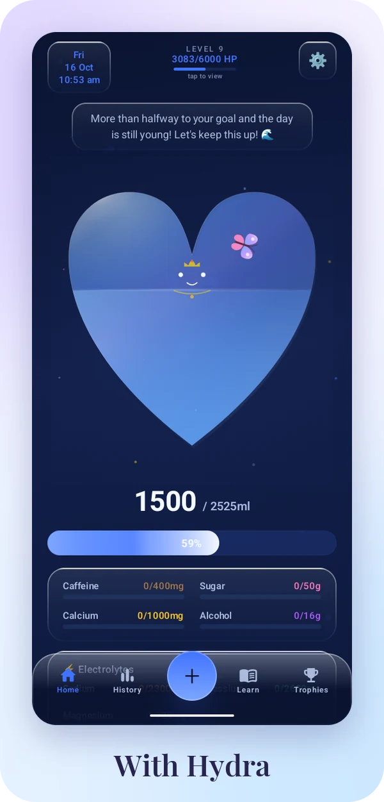</a>
  <a href="docs/hydra-focus.webp">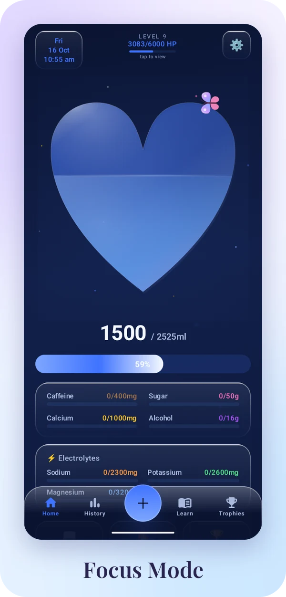</a>

<em>The same moment, with Hydra and in Focus Mode.</em>

**With Hydra**, the app feels alive.

- **Her face follows your day.** She goes from concerned to content to happy to ecstatic as you get closer to your goal, and gets worried if you go over your caffeine or alcohol limit.
- **She talks to you.** What she says depends on the time of day, how far along you are, what you've just had and your streak. There are well over a thousand lines.
- **She remembers.** Hydra keeps track of the last couple of weeks, so she knows when you're on a roll and when you've had a rough patch.
- **She grows with you.** A necklace at Level 2, sparkles at 3, her diary at 5, a crown at 6, flowers at 7, a rainbow shimmer at 8, a butterfly at 9 and her golden legendary form at 10.

**In Focus Mode**, her face and speech bubbles disappear and you're left with a calm,
distraction-free tracker: your goal, your progress and your numbers. Pick it on day one or switch
whenever you like. Neither is the wrong way to use HydraHeart.

*Why the name?* Hydra is short for hydration, and she's definitely got one head, not nine. (Give
her a few levels and there'll be a crown on it.) Heart is what she is: the part of HydraHeart that
cares how you're doing, not just how much you've had.

## Everything you need to stay hydrated

### Effortless drink tracking

Tap the big **+**, pick a category and add a drink. There are 70 of them in real sizes, from a 30 ml
espresso to a litre of water, across Water, Coffee & Tea, Energy Drinks, Soft Drinks, Fruit Juice,
Milk & Calcium and Alcohol. Each one knows its caffeine, sugar, calcium, alcohol and electrolytes.

Every drink also comes with an estimate of how much water it adds to your day. A litre of water
counts in full, a 355 ml latte counts as about 283 ml, and alcohol, energy drinks and the stronger
coffees show how much HydraHeart takes off your total before you add them. These are the app's own
rough estimates for comparing drinks, not exact or medical measurements.

  <a href="docs/screenshots/03-log-coffee.webp">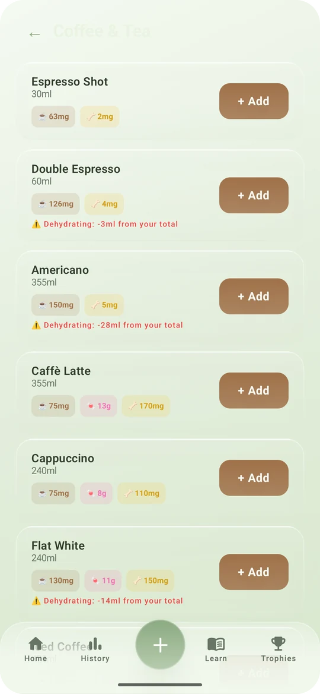</a>
  <a href="docs/screenshots/03-logged.webp">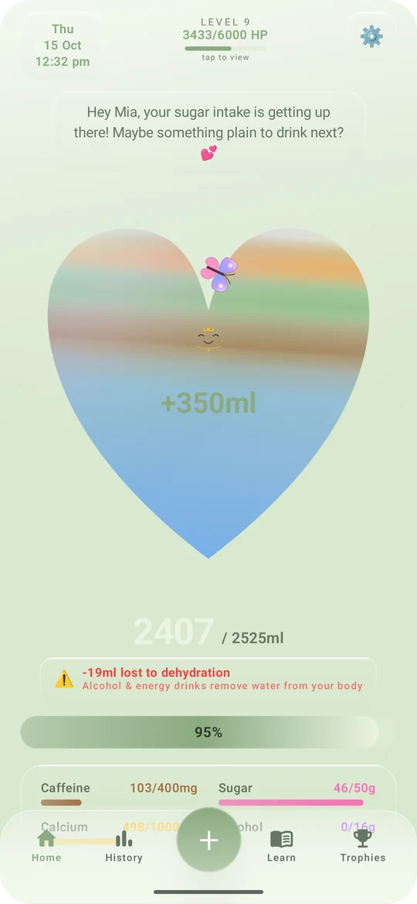</a>
  <a href="docs/screenshots/03-goal-reached.webp">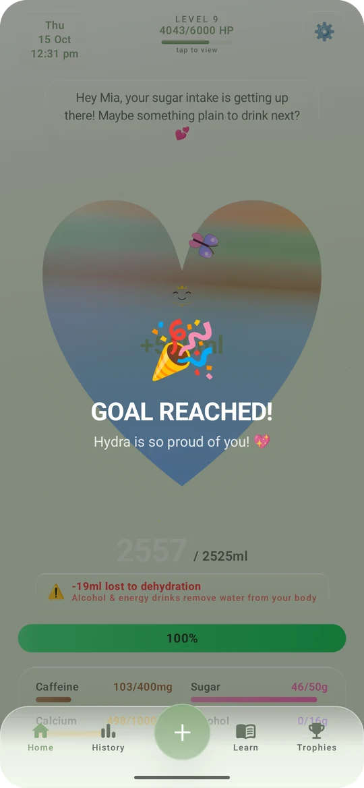</a>

<em>The numbers for every drink, a glass going in, and the moment you hit your goal.</em>

### A goal made for you

Your body isn't average, so your goal isn't a flat 2 litres. HydraHeart works it out from your
weight, how active you are and your climate, and **Why this goal?** shows you exactly how. Rather
pick your own? Switch to **Custom**. You also get daily limits for caffeine, sugar and alcohol, and
targets for calcium, sodium, potassium and magnesium.

  <a href="docs/screenshots/04-daily-goal.webp">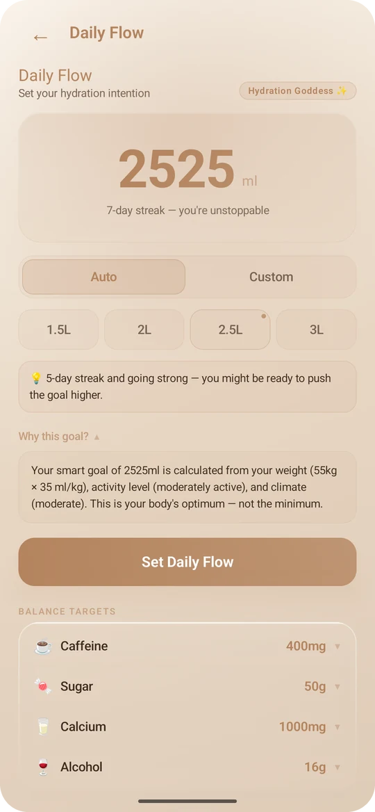</a>
  <a href="docs/screenshots/12-profile.webp">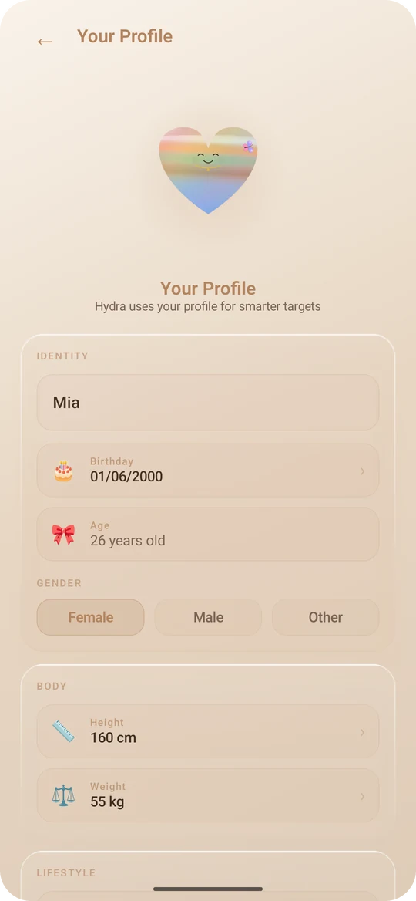</a>

<em>Your goal and where it comes from.</em>

<strong>How your goals are worked out</strong>

| Goal | How HydraHeart sets it |
| --- | --- |
| **Water** | 35 ml for each kg you weigh, plus 300 ml if you're lightly active, 600 ml if you're moderately active or 1 litre if you're very active. Add 600 ml for a hot climate or take off 200 ml for a cold one, then 10% less if you're over 65. It always stays between 1.2 and 5 litres. |
| **Caffeine** | Up to 400 mg a day, or 100 mg if you're under 18 |
| **Sugar** | Up to 50 g |
| **Alcohol** | Up to 16 g |
| **Calcium** | 1,000 mg, or 1,200 mg for women over 50 |
| **Sodium** | Up to 2,300 mg |
| **Potassium** | 2,600 mg for women and 3,400 mg for men |
| **Magnesium** | 320 mg for women and 420 mg for men |

If you choose "Other" for gender, the potassium and magnesium targets sit halfway between.

These numbers are general starting points for healthy adults, in line with common guidance (400 mg
of caffeine a day, for example, is the figure the EFSA and the US FDA use). They don't take
pregnancy or breastfeeding into account and aren't designed for children. HydraHeart is a
wellbeing companion, not a medical device: if you're pregnant, under 18, or have a condition that
affects how much you should drink, ask your doctor what's right for you.

### How are you feeling?

HydraHeart is a mood tracker too, because the tired, stressed days are the ones where the water
bottle gets forgotten. Once a day, pick **Happy**, **Calm**, **Okay**, **Tired** or **Stressed**
and add a note if you like. Hydra answers in her own voice, and every check-in goes into your
**Mood Calendar**: your week as a row of faces and every month coloured by how you felt.

  <a href="docs/moods.webp">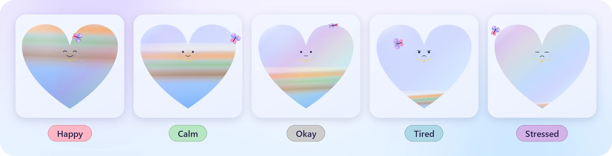</a>

  <a href="docs/screenshots/09-mood.webp">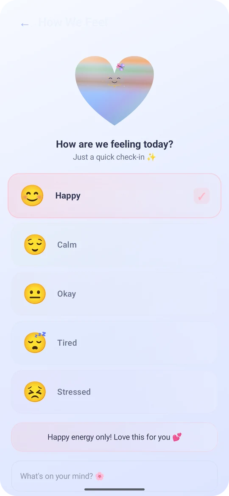</a>
  <a href="docs/screenshots/09-mood-calendar.webp">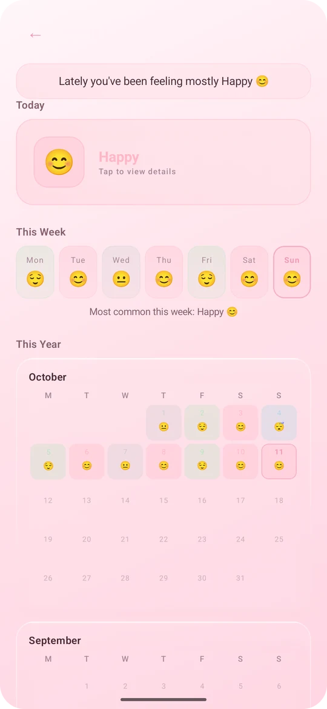</a>
  <a href="docs/screenshots/09-mood-year.webp">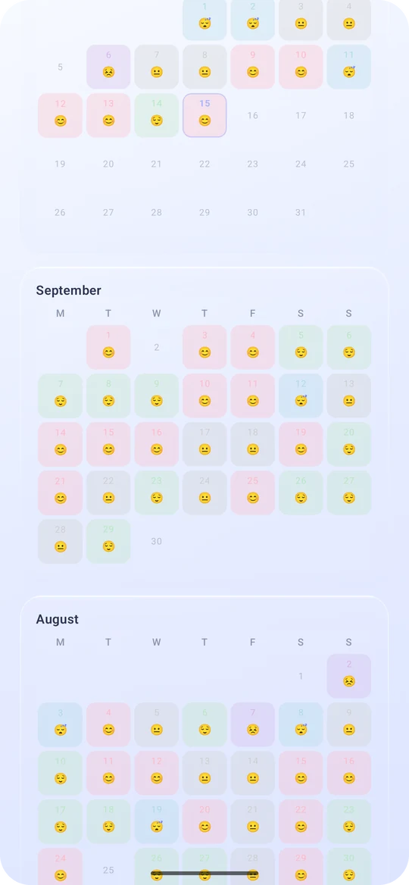</a>

<em>The same Hydra on five different days, a check-in, and the calendar it builds.</em>

### A companion with personality

Hydra can be your **Bestie**, a **Slay Queen**, a **Soft Girl**, in her **Villain Era**, a
**Zen Master** or your **Coach**: same Hydra, completely different voice. Tell her you're tired and
Bestie says *"Rest is so valid Mia 💤"*, while Villain Era says *"Tired? Rest now, scheme later 😈"*.

Two more are hidden. **Cold CEO** turns up when you've been consistently brilliant, and
**Heartbreak Era** turns up when things have been hard and gets softer and more honest with you.
When one unlocks, Hydra tells you herself and you choose whether to switch.

  <a href="docs/personalities.webp">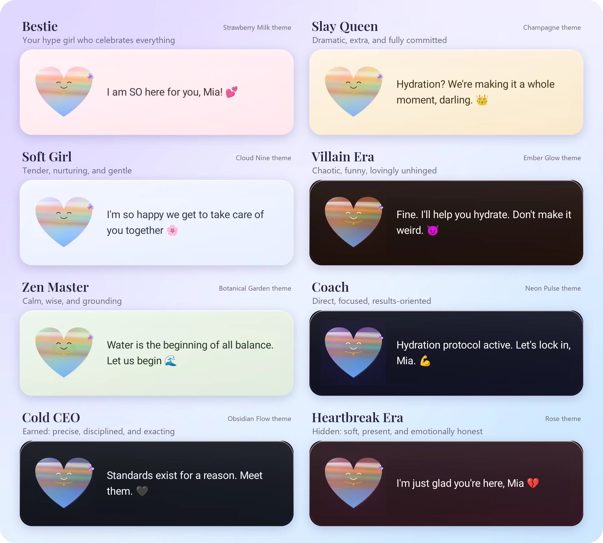</a>

<em>Eight attitudes, each in a theme that suits her.</em>

<strong>When the hidden personalities unlock</strong>

- **Cold CEO:** ten days in a row at 90% or more of your goal, or a solid fortnight at 85% or more.
- **Heartbreak Era:** a week of missed goals, or a week of low water when your moods have mostly been tired or stressed.

  <a href="docs/screenshots/02-unlock-reveal.webp">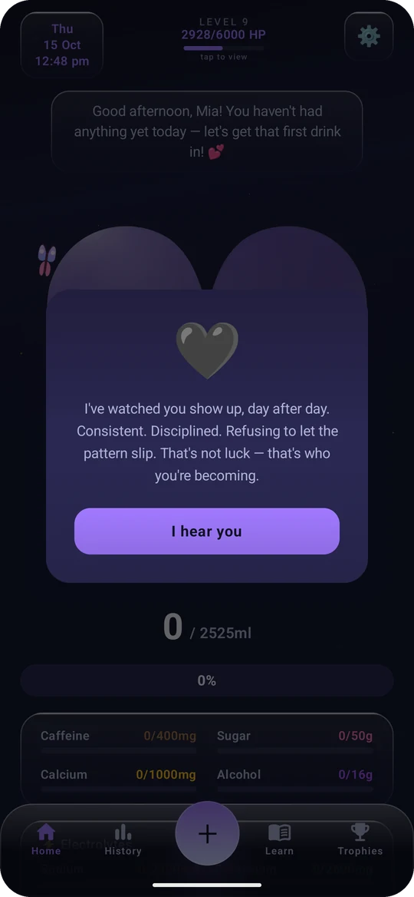</a>
  <a href="docs/screenshots/02-unlock-choice.webp">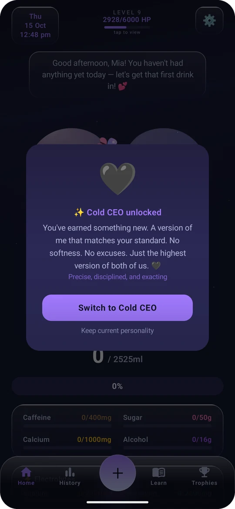</a>
  <a href="docs/screenshots/02-personality.webp">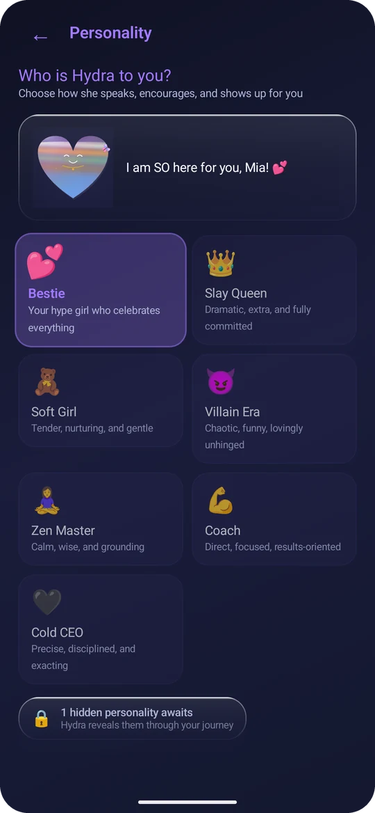</a>

### Progress and history

**History** shows your day, week, month and year: your totals, your average drink, what you drink
most and how often you hit your goal. From Level 5, Hydra keeps a **diary** too, with an entry
for every drink, written by her, about you.

  <a href="docs/screenshots/08-history-week.webp">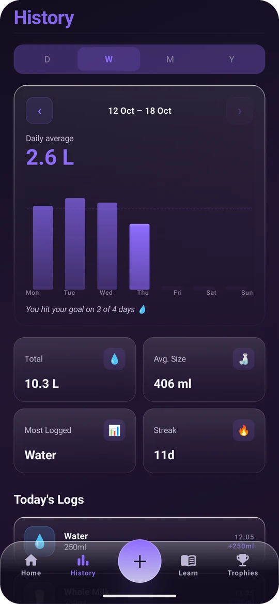</a>
  <a href="docs/screenshots/08-history-month.webp">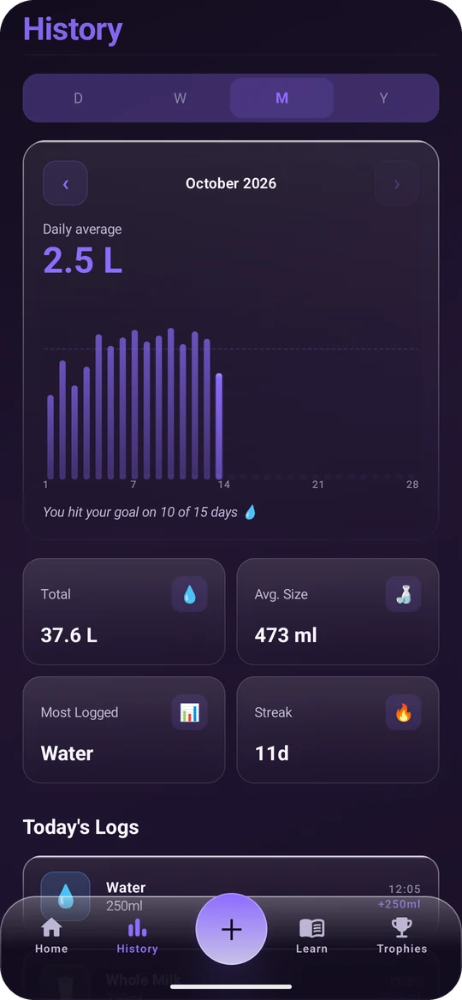</a>
  <a href="docs/screenshots/09-diary.webp">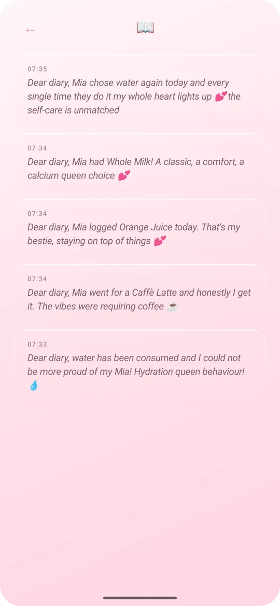</a>

<em>Your week, your month, and Hydra's diary.</em>

### Little moments worth celebrating

Every drink, mood check-in, goal and trophy earns HP, and HP takes Hydra through ten levels, each
with something new for her. There are 60 trophies, from your first sip to a month-long streak and a
Perfect Day where you hit every goal without going over a single limit. Locked ones show how close
you are, and nothing you've earned is ever taken away.

  <a href="docs/screenshots/01-level-popup.webp">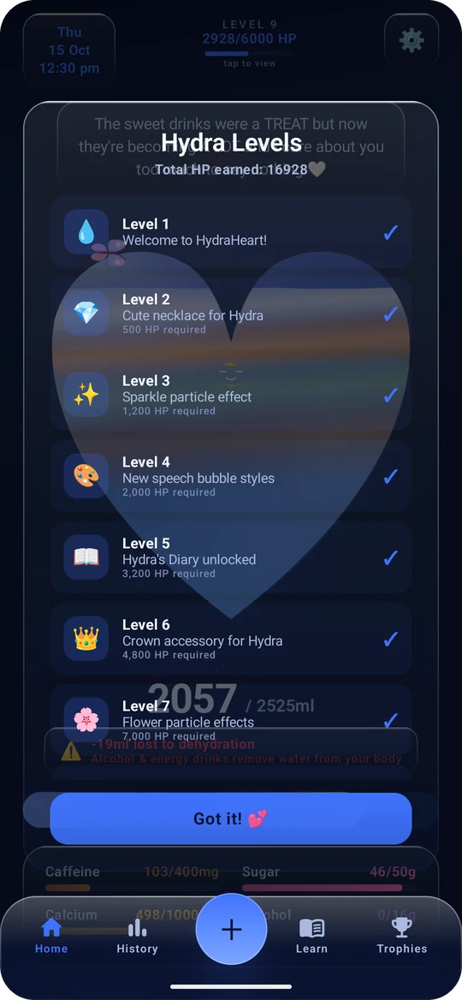</a>
  <a href="docs/screenshots/05-trophies-earned.webp">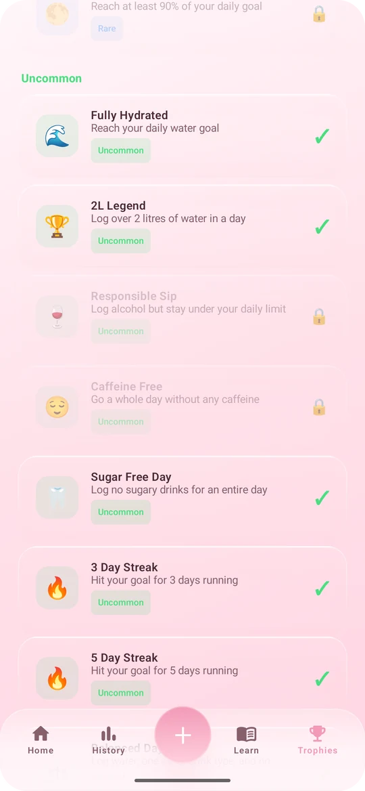</a>

<em>Hydra's ten levels, and a few trophies that have been earned.</em>

### Make it yours

There are thirty themes, eighteen light and twelve dark, and the whole app changes with them, Hydra
included. Six are yours from the start, and the rest open up as you level up or earn certain
trophies. Hydra can also be a droplet, a bottle, a cup, a woman or a bra instead of a heart, wear
any of twelve accessories, use one of eight speech bubble styles or say lines you've written
yourself. The Level 8 to 10 rewards each have their own switch.

  <a href="docs/themes.webp">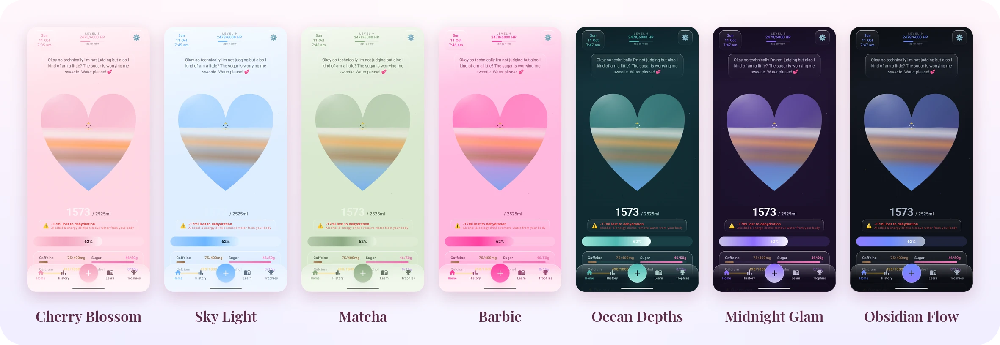</a>

<em>The same morning in all thirty themes.</em>

<strong>Shapes, accessories and speech bubbles</strong>

  <a href="docs/shapes.webp">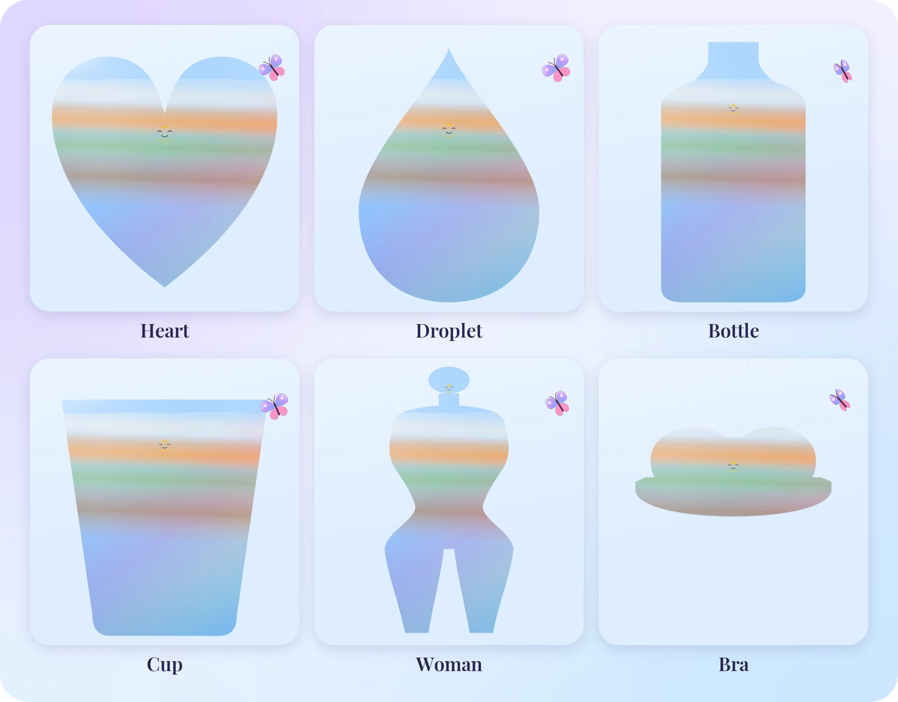</a>

  <a href="docs/screenshots/07-look.webp">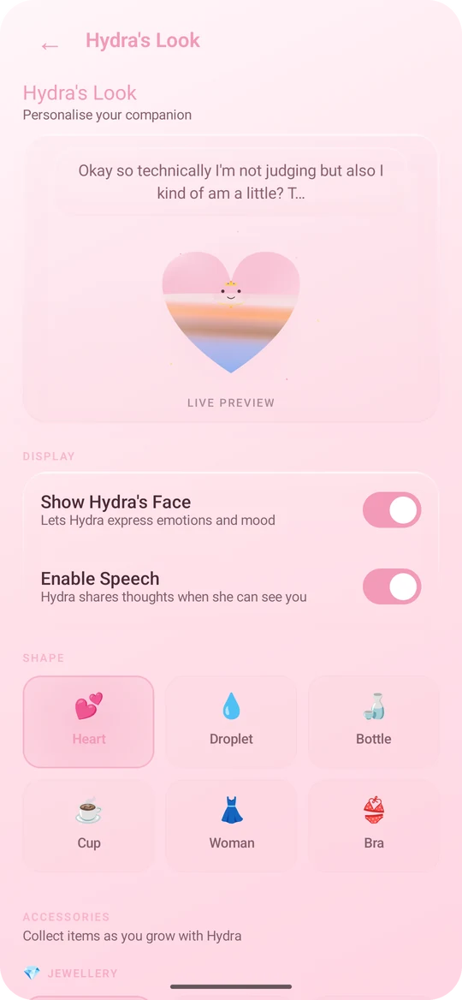</a>
  <a href="docs/screenshots/07-accessories.webp">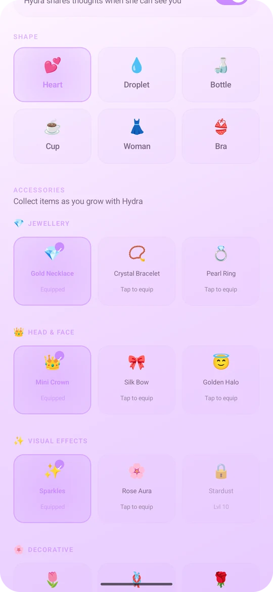</a>
  <a href="docs/screenshots/07-bubbles.webp">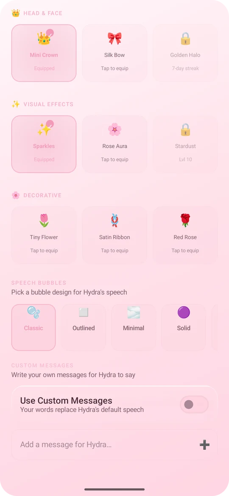</a>

### Gentle reminders

Set as many reminders as you like, at the times that suit your day, and they arrive in Hydra's
voice: not "Time to drink water", but things like "Your future self is texting you: please drink
water". Pick from 50 messages, switch off the ones you don't like, write your own, and choose the
sound.

  <a href="docs/screenshots/11-notification.webp">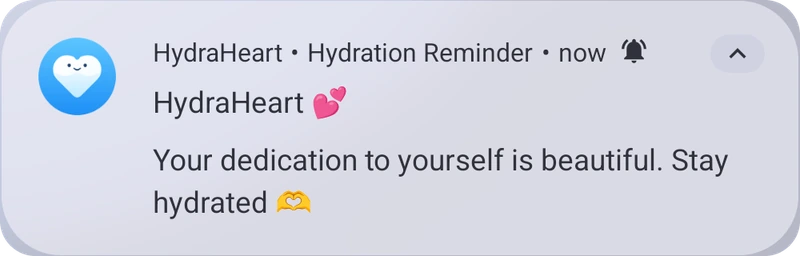</a>

### Learn as you go

Learn has 41 short, friendly articles on hydration, electrolytes, caffeine, sugar, alcohol, skin,
wellbeing and habits, with a new **Today's Lesson** every day and a dozen myth-busters along the
way. They're there to make the basics easy to read, not to replace advice from a doctor.

  <a href="docs/screenshots/10-learn.webp">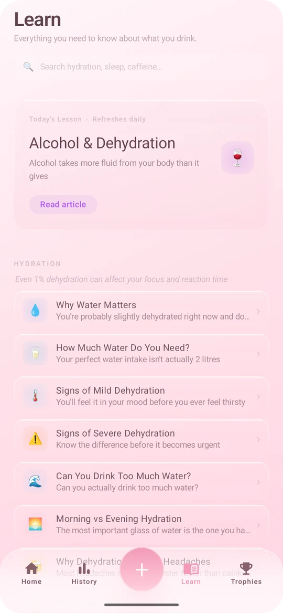</a>
  <a href="docs/screenshots/10-article.webp">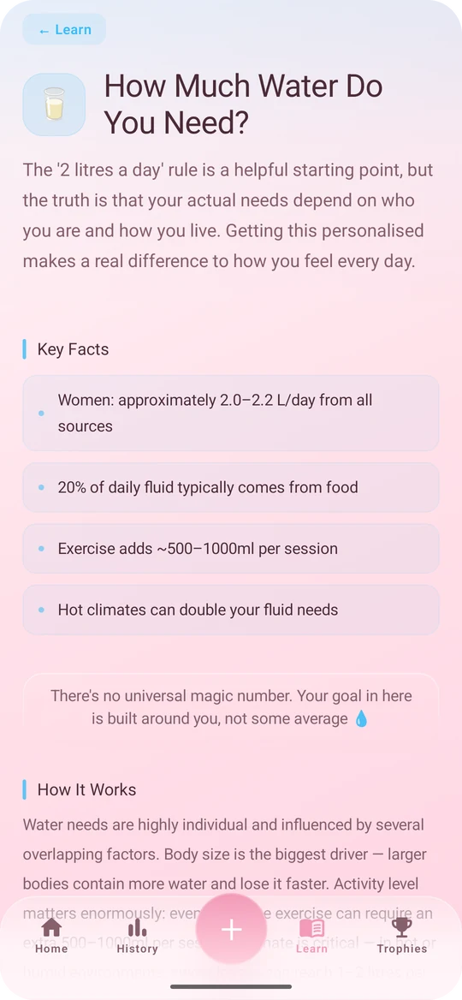</a>

## A healthier habit, without the guilt

**Missed a day? You're still making progress.**

Life gets busy. Sometimes we forget, sometimes we're tired, and sometimes things simply don't go to
plan. One missed day doesn't erase everything you've achieved: your level, your HP, your trophies
and your history stay exactly where they were, and only your streak starts counting again. Hydra
won't tell you off when you come back. She's just glad you're here.

No guilt. No pressure. Just keep going.

## Free means free

| The promise | HydraHeart |
| --- | --- |
| Free to use, forever | ✓ Yes |
| Advertisements | None |
| Subscriptions | None |
| Paywalled features | None |
| Donations | Only ever optional |
| Extra features for people who donate | Never |

There's no way to donate yet. If there ever is, it'll be a way to support development, never a
requirement to use the app, and someone who never donates will get exactly the same HydraHeart as
someone who does. If keeping HydraHeart going ever starts costing me money, that's mine to deal
with, not yours.

## Get HydraHeart

### Availability

HydraHeart isn't on Google Play yet. It's on its way, and when it gets there the link will be right
here. There are no APK downloads in the meantime.

### Your first few minutes

Hydra introduces herself and asks a few things: your name, birthday, height, weight, how active you
are and what the weather's usually like where you live. From that she works out your daily goal.
Then she asks how you'd like her to show up, the **Full Hydra Experience** or **Focus Mode**, and
whether she can send you reminders. You can change all of it later in Settings.

  <a href="docs/first-run.webp">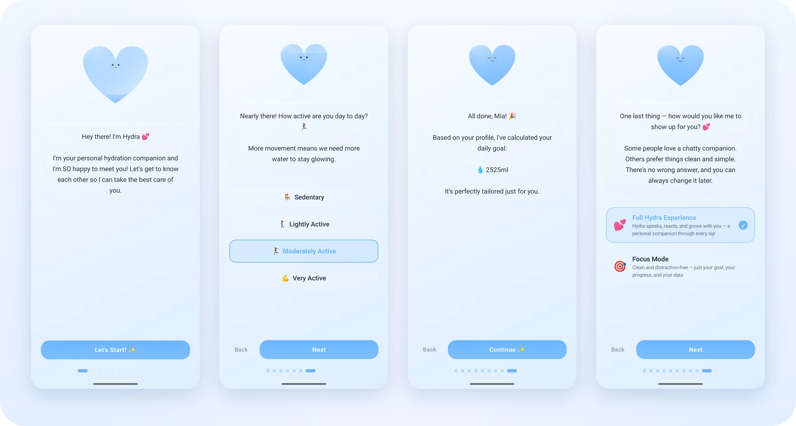</a>

<strong>Everything in Settings</strong>

| Section | What's in it |
| --- | --- |
| **Your Profile** | Name, birthday, gender, height, weight, activity level and climate |
| **How We Feel** | Your mood check-in and the Mood Calendar |
| **Personality** | Hydra's personalities, including any hidden ones you've unlocked |
| **Hydra's Look** | Face, speech, shape, accessories, level rewards, speech bubbles and your own lines |
| **Daily Goals** | Your goal, worked out or custom, and the limits for everything else |
| **Calendar** | Day or month first, a 12 or 24-hour clock, and which day your week starts |
| **Reminders** | Times, messages and the sound |
| **Themes** | All 30 themes |
| **Units** | Millilitres, fluid ounces or litres |
| **General** | Haptics, sounds, animations, battery-aware mode, reduce motion, keep the screen on, and the language |
| **About** | The version, what's new, the privacy policy and the terms |

HydraHeart speaks English (with US or UK spelling), German and Spanish.

### Privacy and permissions

HydraHeart has no servers, no account, no analytics and no ads, and it doesn't have the internet
permission, so it can't send your drinks, moods or notes anywhere itself. What you log is kept in
HydraHeart's private storage on your phone, where other apps can't read it.

- **Your phone's own backup can include it.** HydraHeart allows Android's standard app backup, so if backup to your Google account is on, Android may save HydraHeart's data and restore it when you reinstall or move to a new phone. That copy is handled by Android and Google, not by me, and you can turn it off in your phone's backup settings.
- **Uninstalling deletes what's on your phone,** but not a backup Android has already made.
- **The fonts come from Google Play services,** which downloads them and keeps them on your phone. If they can't be fetched, the app uses the system font.

| Permission | What it's for |
| --- | --- |
| **Notifications** | Showing Hydra's reminders. Say no and everything else still works. |
| **Alarms & reminders** | Sending your reminders at the times you set |
| **Run at startup** | Putting your reminders back after your phone restarts |
| **Vibration** | The little haptic taps around the app |

## Under the hood

HydraHeart is a native Android app written in Kotlin with Jetpack Compose. It runs entirely on the
phone: there's no server, no account system and no network code.

### Tech stack

| | |
| --- | --- |
| **Language** | Kotlin 2.2 |
| **UI** | Jetpack Compose (BOM 2024.12.01) with Material 3 and Material icons |
| **Navigation** | Navigation Compose |
| **State** | One AndroidX `ViewModel` holding Compose state |
| **Storage** | Jetpack DataStore (Preferences), with lists saved as JSON through Gson |
| **Reminders** | `AlarmManager`, plus a boot receiver that puts them back after a restart |
| **Fonts** | Playfair Display and DM Sans as Google downloadable fonts |
| **Android** | 8.0 (API 26) and up, compiled against API 36.1 |
| **Build** | Gradle 9.6 (through the wrapper) and Android Gradle Plugin 9.4 |

Hydra herself is drawn in code on a Compose `Canvas`: every shape, the layered colours of each
drink, her face, her accessories and her level effects. There are no images or animation files
behind her.

### Requirements

- Android Studio, recent enough for Android Gradle Plugin 9.4
- JDK 17 or newer (the one bundled with Android Studio works)
- The Android SDK Platform for API 36.1
- A phone or emulator running Android 8.0 or newer

### Contributing

I'm not taking code contributions (pull requests) at the moment, because HydraHeart isn't open
source (see the [licence](#licence)). Bug reports and ideas are very welcome, though, and they're
the best way to help: [open an issue](https://github.com/iri-dev/HydraHeart/issues/new) and tell me
what happened or what you'd love to see. Every idea gets measured against the promises above: free
for everyone, no ads, no subscriptions and no guilt.

## A note from the developer

HydraHeart is my first app, and it started as something I wanted to build for myself. I wanted to
drink more water, but I
struggled with motivation, and the apps I tried wanted a subscription before they'd really help. I
wanted something different: something enjoyable, encouraging and genuinely free.

I don't measure this project's success by downloads or ratings. I'm not a machine, and those
numbers aren't the point. If HydraHeart helps even one person build a healthier habit or feel a
little better in their everyday life, then creating it was worth it, and they don't owe me anything
for it.

Thank you for being here.

— [Iri](https://github.com/iri-dev)

## Licence, feedback and support

### Feedback

I make HydraHeart on my own (I also make [WardenOne](https://github.com/iri-dev/WardenOne)), and I
read every message myself.

- **Found a bug?** [Open an issue](https://github.com/iri-dev/HydraHeart/issues/new) and say what you were doing and what happened. A screenshot and what Hydra was doing at the time help the most.
- **Got an idea?** [Open an issue](https://github.com/iri-dev/HydraHeart/issues/new) and tell me about it.
- **Just want to say hi?** Email [iri.devsupport@gmail.com](mailto:iri.devsupport@gmail.com) or find me on Discord as `iri.dev`.

### Supporting HydraHeart

There's nothing to pay for and no way to donate yet. The most helpful things right now are telling
me what works and what doesn't, and sharing HydraHeart with someone who might like it.

### Licence

Copyright (C) 2026 Iri. All rights reserved.

HydraHeart isn't open source. You're welcome to read the code and build the app for your own use,
but please don't copy, modify or redistribute it, or reuse parts of it in other projects, without
my written permission.

### Credits

The fonts are Playfair Display and DM Sans from Google Fonts (SIL Open Font License). HydraHeart is
built with Jetpack Compose and AndroidX, plus Gson (both Apache License 2.0). The emoji are your
phone's own.

<em>Thank you for looking after yourself. Now go and have a glass of water.</em> 💜

