<div align="center">

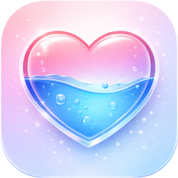

# HydraHeart – your water tracker

<p><strong>Drink something. Watch Hydra fill up.</strong></p>

**A water tracker for Android built around Hydra, a little glass heart who fills with the colours
of whatever you drink. She talks to you, remembers how your week's been going, levels up with you
and gives you a nudge when it's been a while. And all of it stays on your phone.**


[](https://github.com/iri-dev/HydraHeart/issues/new)

</div>

> ### No account. No internet. No tracking. No ads.
>
> **No sign-up · Works offline · Your data stays on your phone**
>
> HydraHeart doesn't even have the internet permission, so it couldn't send your drinks, moods or
> profile anywhere if it wanted to. There's nothing to sign in to and no analytics. Everything is
> saved in the app's own private storage on your phone.

HydraHeart tracks what you actually drink, not just water. 70 drinks, with their caffeine, sugar,
calcium, alcohol and electrolytes, and how much of each one really hydrates you. Then it turns all
of that into a companion you'll actually want to open.

**Jump to:** [Meet Hydra](#meet-hydra) · [Personalities](#eight-personalities) · [Logging drinks](#logging-drinks) · [Goals](#a-goal-that-fits-you) · [Themes](#30-themes) · [Reminders](#reminders-that-sound-like-hydra) · [Privacy](#privacy--permissions) · [How it works](#how-hydraheart-works)

<p align="center">
  <a href="docs/hero.webp">
    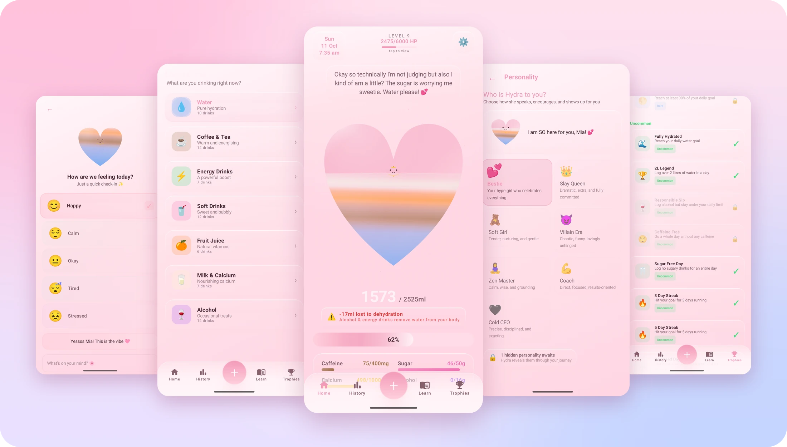
  </a>
</p>
<p align="center"><em>Hydra at 62%. Water, a latte, an orange juice and some milk, all in her heart, and she has opinions about the sugar. (Click any image to see it full size.)</em></p>

# Quick install

HydraHeart isn't on the Play Store, so you build it yourself. It only takes a few minutes.

1. Clone this repo and open the folder in [Android Studio](https://developer.android.com/studio). It comes with the JDK the build uses, so just let Gradle sync.
2. Plug your phone in with USB debugging switched on, or start an emulator.
3. Pick the **HydraHeart** run configuration and press **Run**.

Or from a terminal, with your phone plugged in:

```bash
./gradlew :hydraheart2:installDebug
```

**Compatibility:** Android 8.0 (API 26) and newer. Built for Android 16 (API 36).

<details>
<summary><strong>Updating without losing your data</strong></summary>

Installing a new build over the top keeps everything. Your profile, drinks, streak, trophies, the
lot. Just press Run again, or run `installDebug` again.

Uninstalling is the only thing that wipes it, because it all lives in the app's private storage.
Be careful if you build on a different computer: a debug build is signed with that computer's own
key, so Android won't install it over the top of one built somewhere else. Copy
`~/.android/debug.keystore` across from the first computer and it'll install over the top like
normal.

</details>

## First run

Hydra introduces herself and asks a few things: your name, birthday, gender, height, weight, how
active you are and what the weather's usually like where you live. From that she works out your
daily goal ([more on that below](#a-goal-that-fits-you)).

Then she asks how you'd like her to show up. **Full Hydra Experience** means she talks, reacts and
grows with you. **Focus Mode** is clean and quiet, just your goal, your progress and your numbers.
Last of all she asks if she can send you reminders, and "maybe later" is a perfectly good answer.
You can change all of it later anyway.

<p align="center">
  <a href="docs/first-run.webp">
    
  </a>
</p>
<p align="center"><em>Four of the eleven steps, including the goal she works out for you.</em></p>

<details>
<summary><strong>See the complete first-run journey</strong></summary>

<p align="center">
  <a href="docs/screenshots/00-onboarding-hello.webp">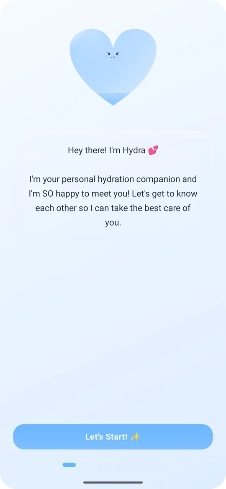</a>
  <a href="docs/screenshots/00-onboarding-birthday.webp">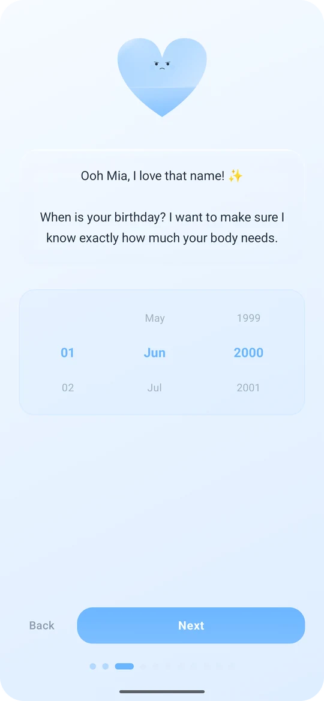</a>
  <a href="docs/screenshots/00-onboarding-gender.webp">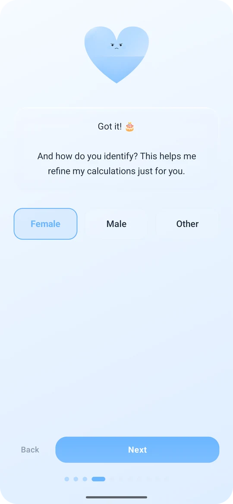</a>
  <a href="docs/screenshots/00-onboarding-activity.webp">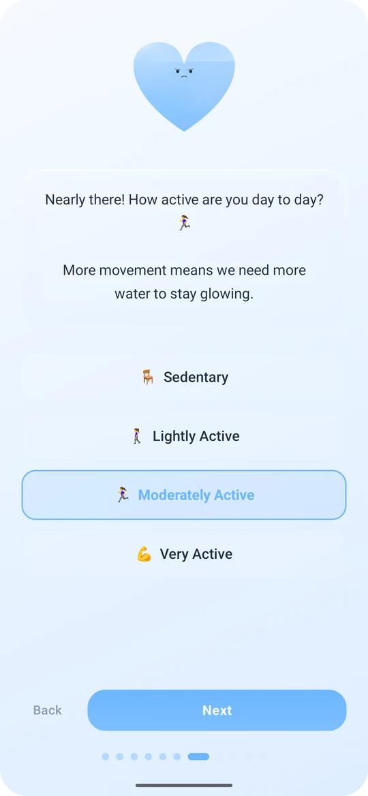</a>
  <a href="docs/screenshots/00-onboarding-climate.webp">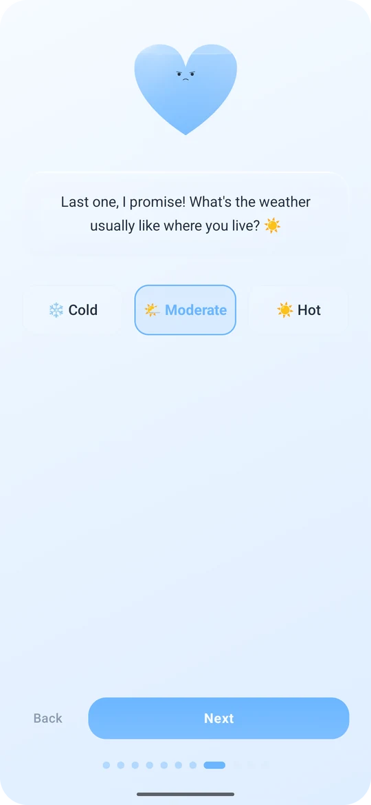</a>
  <a href="docs/screenshots/00-onboarding-goal.webp">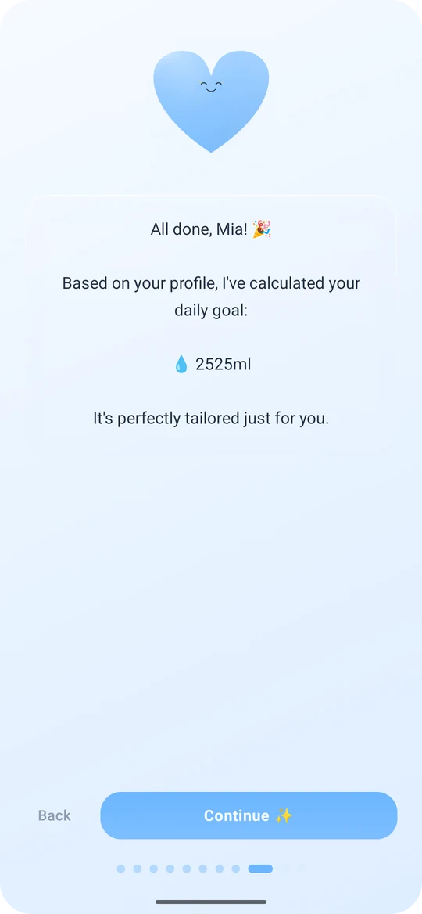</a>
  <a href="docs/screenshots/00-onboarding-style.webp">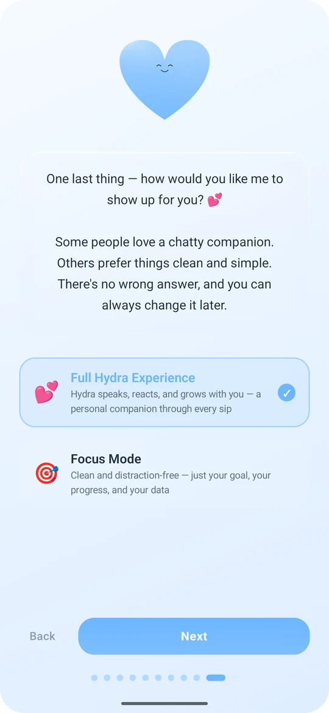</a>
  <a href="docs/screenshots/00-onboarding-reminders.webp">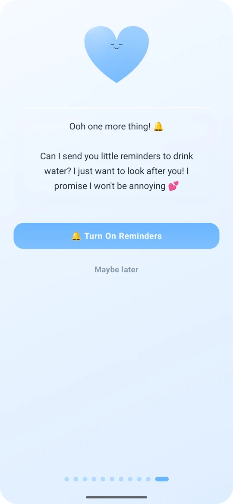</a>
  <a href="docs/screenshots/00-onboarding-done.webp">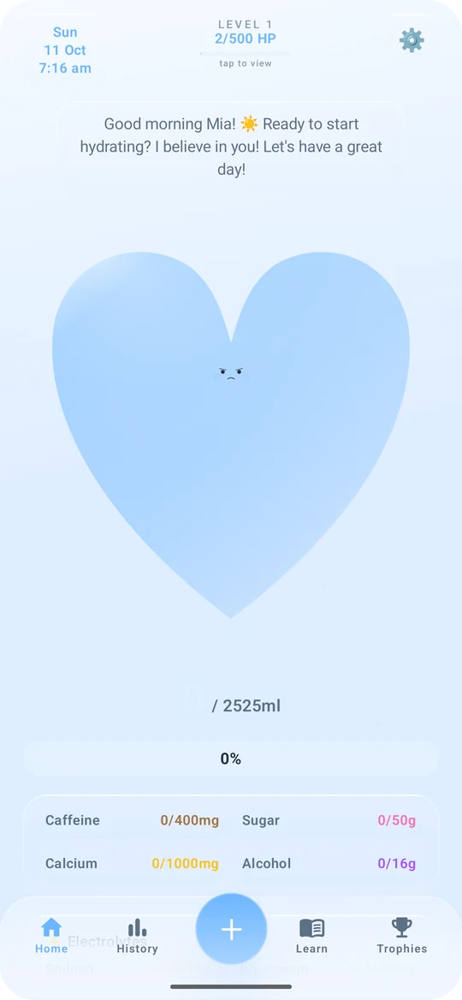</a>
</p>

</details>

# Why HydraHeart exists

Most water trackers are a number, a progress bar and a notification you learn to swipe away. They
tend to last about a week. I wanted one that felt more like a friend. Someone who's genuinely
pleased when you drink some water, a bit dramatic when you've had three coffees, and kind about it
when you're having a rubbish day.

So HydraHeart is built around Hydra. She *is* the progress bar, but she's also the point. The rest
of the app (the drink database, the goal maths, the trophies, the Learn articles) is there so that
what she tells you is true and useful.

A few rules I've stuck to while building it:

- **Gentle, not guilty.** Hydra never makes you feel bad about a bad day. Even her cheekiest reminder comes with a wink: "The audacity of forgetting to hydrate! (joking. drink water)"
- **Honest numbers.** A 355 ml latte isn't 355 ml of water. It's 300 ml, minus a little for the caffeine. Every drink knows how much it really hydrates you, and the app tells you when something takes water back out.
- **Your data is yours.** No account, no internet permission, no analytics. Not even a crash reporter.
- **Fun is a feature.** Levels, trophies, themes and accessories are there because they make coming back feel nice, and coming back is the whole game.

# Why the name **HydraHeart**?

**Hydra** is her name. It's short for hydration, and she's definitely got one head, not nine.
(Give her a few levels and there'll be a crown on it.)

**Heart** is what she is. A glass heart that fills up as you drink, in the colours of what you've
had. It's also the bit that makes HydraHeart different from a counter. It cares how you're doing,
not just how much you've had.

<p align="center">
  
</p>

# Meet Hydra

Hydra lives on the Home screen, and she *is* your progress. Every drink you log pours into her in
its own colour. Water is blue, coffee is brown, orange juice is, well, orange, and milk is white.
Each layer is sized by how much water that drink actually gave you, so a big glass of water fills
her a lot more than an espresso does.

- **She has moods.** Her face goes from concerned to content to happy to ecstatic as you get closer to your goal. Go over your caffeine or alcohol limit and she gets worried, whatever your water says. Way too much sugar and she's concerned.
- **She talks.** What she says depends on the time of day, how far along you are, what you've just had, which limit you're pushing, your streak and the personality you picked. There are well over a thousand lines.
- **She remembers.** Hydra keeps track of the last couple of weeks: your streak, the days you missed, whether you're trending up or down. It changes what she says, and it's how the hidden personalities find you.
- **She reacts.** Tap her and she bounces and glows.
- **She grows with you.** A necklace at Level 2, sparkles at 3, new speech bubbles at 4, her diary at 5, a crown at 6.

Under her you get today's total, a warning when something's taken water back, and bars for
caffeine, sugar, calcium and alcohol, plus sodium, potassium and magnesium. Then your diary, your
streak and trophy count, the next level reward, and your recent drinks with a one-tap **Undo**.

<p align="center">
  <a href="docs/screenshots/01-home.webp">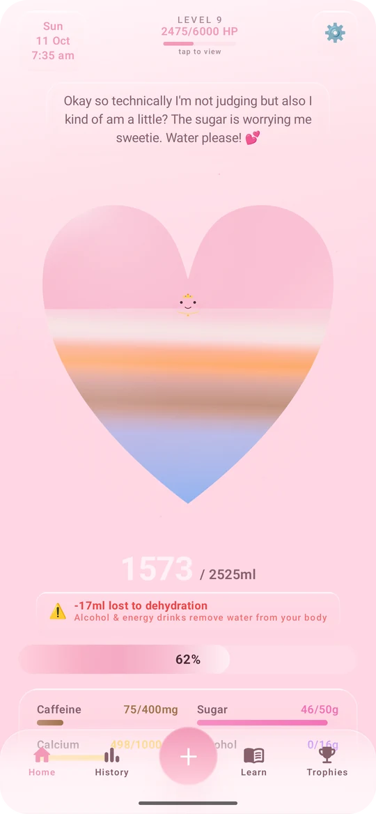</a>
  <a href="docs/screenshots/01-home-details.webp">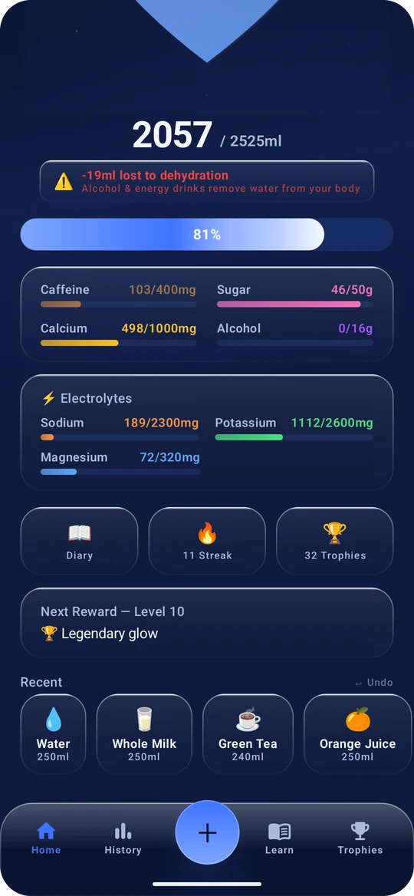</a>
  <a href="docs/screenshots/01-level-popup.webp"></a>
</p>
<p align="center"><em>Home, the rest of Home, and the level list you get by tapping the level at the top.</em></p>

**Find it:** the **Home** tab.

# Eight personalities

Hydra can be your **Bestie**, a **Slay Queen**, a **Soft Girl**, in her **Villain Era**, a
**Zen Master** or your **Coach**. Same Hydra, completely different voice. It changes everything
she says, from Home to her replies when you check in with your mood.

Two more are hidden, and Hydra only offers them when she notices a pattern:

- **Cold CEO** turns up when you've been consistently brilliant. Ten days in a row at 90% or more, or a solid fortnight at 85% or more without ignoring your reminders.
- **Heartbreak Era** turns up when things have been hard. A week of missed goals, or a rough week when your moods have mostly been tired or stressed. She gets softer and more honest with you.

When one unlocks Hydra tells you herself, and you get to choose whether to switch.

<p align="center">
  <a href="docs/personalities.webp">
    
  </a>
</p>
<p align="center"><em>The same Hydra and the same drinks, with eight completely different attitudes.</em></p>

<details>
<summary><strong>See a hidden personality unlock</strong></summary>

<p align="center">
  <a href="docs/screenshots/02-unlock-reveal.webp"></a>
  <a href="docs/screenshots/02-unlock-choice.webp"></a>
  <a href="docs/screenshots/02-personality.webp"></a>
</p>

Cold CEO unlocking after an eleven-day streak. You can switch to her straight away or keep the
personality you've got. She'll be waiting in Settings either way.

</details>

**Find it:** Settings → **Personality**.

# Logging drinks

Tap the big **+** and pick a category: **Water**, **Coffee & Tea**, **Energy Drinks**, **Soft
Drinks**, **Fruit Juice**, **Milk & Calcium** or **Alcohol**. There are 70 drinks in real sizes,
from a 30 ml espresso shot to a litre of water.

Every drink knows what's in it. How much of it is water, and its caffeine, sugar, calcium, alcohol,
sodium, potassium and magnesium. Drinks that dehydrate you (alcohol, energy drinks and the stronger
coffees) tell you how much water they'll take back before you add them, and Home keeps a running
total of what you've lost.

Press **+ Add** and Hydra fills up, the amount floats up out of her heart, and she has something to
say about it. Got it wrong? **Undo** is right there on Home.

<p align="center">
  <a href="docs/screenshots/03-log-categories.webp">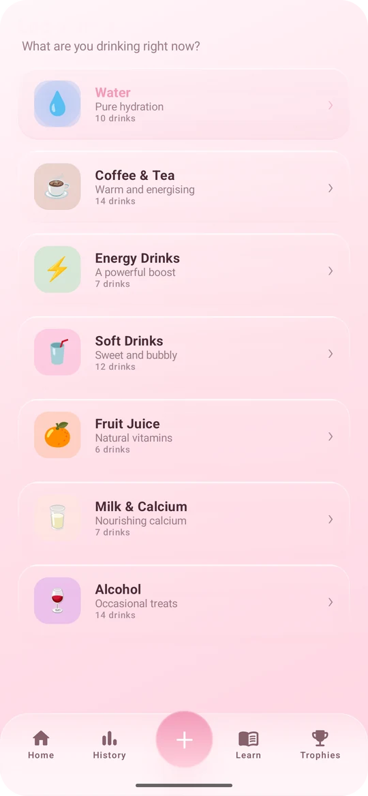</a>
  <a href="docs/screenshots/03-log-coffee.webp"></a>
  <a href="docs/screenshots/03-logged.webp"></a>
</p>
<p align="center"><em>Seven categories, the numbers for every drink, and 500 ml going in.</em></p>

**Find it:** the **+** in the middle of the bottom bar.

# A goal that fits you

Your goal isn't a flat 2 litres. HydraHeart starts with 35 ml for every kilo you weigh, adds 300 to
1,000 ml depending on how active you are, adjusts for your climate (200 ml less when it's cold,
600 ml more when it's hot) and eases off a little if you're over 65. **Why this goal?** shows you
exactly how yours was worked out.

Would rather pick your own? Switch to **Custom**. And after a good streak Hydra might suggest it's
time to aim a bit higher.

You also get daily limits and targets for caffeine (400 mg), sugar (50 g), calcium (1,000 mg) and
alcohol (16 g), plus sodium, potassium and magnesium, adjusted for your age and gender.

<p align="center">
  <a href="docs/screenshots/04-daily-goal.webp"></a>
  <a href="docs/screenshots/12-profile.webp"></a>
</p>
<p align="center"><em>Your goal and where it comes from. (Mia is made up, by the way. So are her drinks.)</em></p>

**Find it:** Settings → **Daily Goals**, which Hydra calls your *Daily Flow*.

# Levels, HP and 60 trophies

Everything you do earns HP. 5 for each drink, 50 for reaching your goal plus another 10 for every
day of your streak, and every trophy pays out too. HP takes Hydra through ten levels, all the way to
20,000 HP, and each level unlocks something new for her.

There are 60 trophies in five rarities: 13 Common, 16 Uncommon, 13 Rare, 9 Epic and 9 Legendary.
Your first sip, two litres in a day, a sugar-free day, a week-long streak, a Perfect Day where you
hit every goal without going over a single limit... Plenty of the locked ones show how close you
are.

<p align="center">
  <a href="docs/screenshots/05-trophies.webp">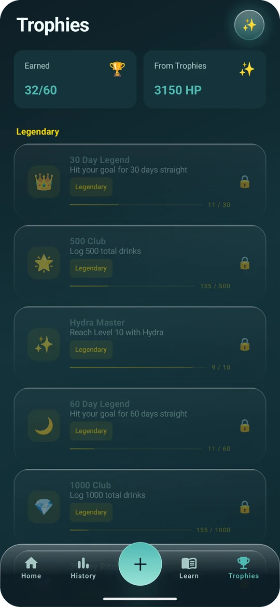</a>
  <a href="docs/screenshots/05-trophies-earned.webp"></a>
</p>
<p align="center"><em>30 down, 30 to go. The Legendary ones are a long game.</em></p>

**Find it:** the **Trophies** tab, and tap the level at the top of Home for the level list.

# 30 themes

Cherry Blossom, Sky Light, Matcha, Barbie, Ocean Depths, Midnight Glam, Obsidian Flow and 23 more,
light and dark. The whole app changes with them, Hydra included. Some unlock as you level up and
some need a trophy. Barbie, for example, wants a Perfect Day.

<p align="center">
  <a href="docs/themes.webp">
    
  </a>
</p>
<p align="center"><em>The same morning in seven of the thirty themes.</em></p>

**Find it:** Settings → **Themes**.

# Make her yours

**Six shapes.** Hydra doesn't have to be a heart. She can be a droplet, a bottle, a cup, a woman or
a bra, and she fills up just the same.

<p align="center">
  <a href="docs/shapes.webp">
    
  </a>
</p>
<p align="center"><em>One Hydra, six shapes, same crown.</em></p>

**Twelve accessories** in four groups. Jewellery (a gold necklace, crystal bracelet and pearl ring),
head and face (a mini crown, silk bow and golden halo), visual effects (sparkles, a rose aura and
stardust) and decorative bits (a tiny flower, satin ribbon and red rose). Most of them unlock as you
level up.

**Eight speech bubble styles**, from Classic and Outlined to Glow and Neon. You can also write your
own lines for Hydra to say instead of hers, or switch off her face and speech altogether.

<p align="center">
  <a href="docs/screenshots/07-look.webp"></a>
  <a href="docs/screenshots/07-accessories.webp"></a>
  <a href="docs/screenshots/07-bubbles.webp"></a>
</p>
<p align="center"><em>The live preview updates as you go.</em></p>

**Find it:** Settings → **Hydra's Look**.

# Moods, the diary and history

**How We Feel** is a quick daily check-in. Pick Happy, Calm, Okay, Tired or Stressed, add a note if
you like, and Hydra answers in her own voice. The **Mood Calendar** then shows today, this week and
the whole year at a glance, and tells you how you've been feeling lately.

From Level 5 Hydra keeps a **diary** too. Every drink gets an entry, written by her, about you.
*"Dear diary, Mia went for a Caffè Latte and honestly I get it. The vibes were requiring coffee."*

<p align="center">
  <a href="docs/screenshots/09-mood.webp"></a>
  <a href="docs/screenshots/09-mood-calendar.webp"></a>
  <a href="docs/screenshots/09-diary.webp"></a>
</p>
<p align="center"><em>A check-in, the calendar it builds, and Hydra's diary.</em></p>

**History** has day, week, month and year views, your total, average drink size, what you log most
and your streak, plus a little insight like "11 days in a row — you drink most in mornings." Below
that is every drink you've had today, with the time. For now the charts are built from today's
drinks. Earlier days are kept as daily summaries, which is what drives your streak, Hydra's memory
and the trophies.

<p align="center">
  <a href="docs/screenshots/08-history.webp">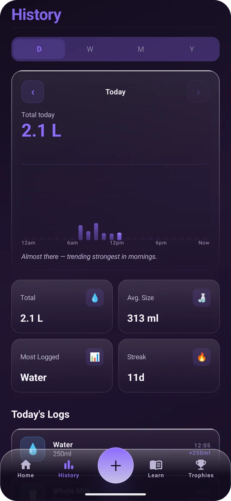</a>
</p>

**Find it:** Settings → **How We Feel**, the **Diary** tile on Home, and the **History** tab.

# Learn

41 short, friendly articles in nine topics: Hydration, Electrolytes, Caffeine, Sugar, Alcohol,
Energy Drinks, Beauty & Skin, Wellbeing and Habits. Each one has the key facts and a proper
explanation, and there are a dozen myth-busters along the way ("You need exactly 8 glasses a day"
isn't true, by the way). There's a new **Today's Lesson** every day, and you can search the lot.

<p align="center">
  <a href="docs/screenshots/10-learn.webp"></a>
  <a href="docs/screenshots/10-article.webp"></a>
</p>

**Find it:** the **Learn** tab.

# Reminders that sound like Hydra

You start with four: Morning, Midday, Afternoon and Night. Add as many as you like, move them with
Hydra's own time picker, or delete the ones you don't need. Hydra even tells you how nicely they're
spread across your day.

They come through in her voice. Not "Time to drink water", but things like "I'm not saying you
forgot... but you forgot" or "Your future self is texting you: please drink water". Pick from 50
preset messages, switch off the ones you don't like and write your own. Choose the sound or keep
them silent. And they keep working after your phone restarts.

<p align="center">
  <a href="docs/screenshots/11-notification.webp">
    
  </a>
</p>

<p align="center">
  <a href="docs/screenshots/11-reminders.webp">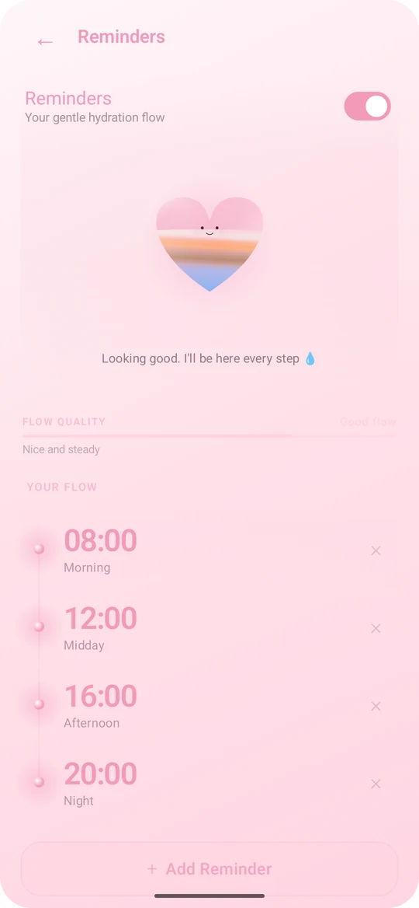</a>
  <a href="docs/screenshots/11-time-picker.webp">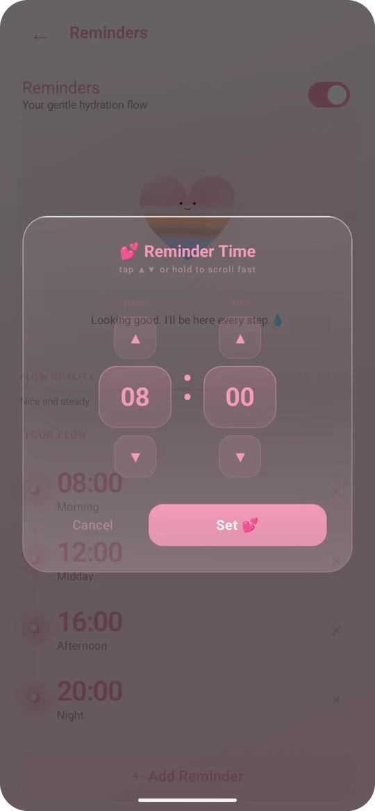</a>
</p>
<p align="center"><em>A real reminder, your flow, and the time picker.</em></p>

**Find it:** Settings → **Reminders**.

# Settings

| Section | What's in it |
| --- | --- |
| **Your Profile** | Name, birthday, gender, height, weight, activity level and climate |
| **How We Feel** | Your mood check-in and the Mood Calendar |
| **Personality** | Hydra's personalities, including any hidden ones you've unlocked |
| **Hydra's Look** | Face, speech, shape, accessories, speech bubbles and your own lines |
| **Daily Goals** | Your goal, worked out or custom, and the limits for everything else |
| **Calendar** | Day or month first, a 12 or 24-hour clock, and which day your week starts |
| **Reminders** | Times, messages and the sound |
| **Themes** | All 30 themes |
| **Units** | Millilitres, fluid ounces or litres |
| **General** | How much Hydra buzzes, plays sounds and animates, battery-aware mode, reduce motion, keep the screen on, and the language |
| **About** | The version (tap it to see what's new), the privacy policy and the terms |

HydraHeart speaks English (with US or UK spelling), German and Spanish.

<p align="center">
  <a href="docs/screenshots/12-settings.webp">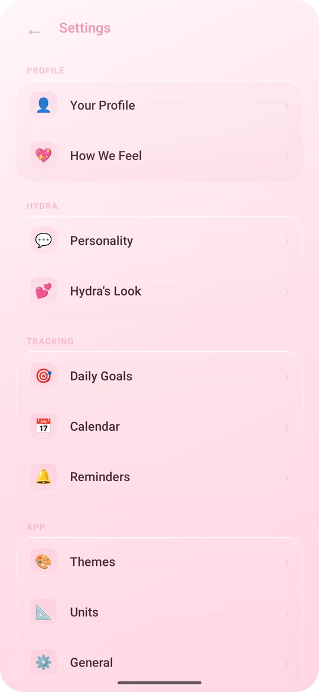</a>
  <a href="docs/screenshots/13-about.webp">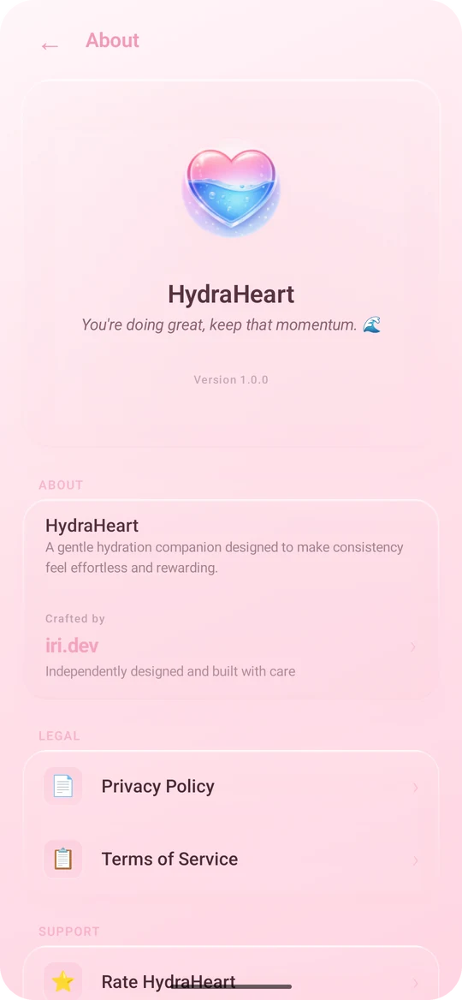</a>
</p>

<p align="center">
  
</p>

# Privacy & permissions

HydraHeart asks for four permissions, and none of them can reach the internet.

| Permission | What it's for |
| --- | --- |
| **Notifications** | Showing Hydra's reminders. Say no and everything else still works. |
| **Alarms & reminders** | Sending your reminders at the times you set. |
| **Run at startup** | Putting your reminders back after your phone restarts. |
| **Vibration** | The little haptic taps around the app. |

That's the lot. No internet, no location, no contacts, no camera, no photos or files.

- **Everything stays on your phone.** Your profile, drinks, moods, diary and settings are saved in HydraHeart's private storage. Other apps can't read it, and uninstalling HydraHeart deletes it.
- **No accounts, no analytics, no ads.** There's nothing to sign in to and nothing reporting back.
- **The fonts are the one thing that comes from the internet, and HydraHeart doesn't fetch them.** Playfair Display and DM Sans are Google Fonts. Google Play services downloads them and keeps them on your phone. If they can't be fetched, the app just uses the system font.
- **Android's own backup.** If you've switched on Android backup, your phone can include HydraHeart's data in it like any other app's. That's between your phone and your Google account.

# How HydraHeart works

There's one activity and one ViewModel. Compose draws every screen, and `HydraViewModel` holds
everything they show: your drinks, goals, levels and trophies, and Hydra's mood, memory and speech.
Whenever something changes it gets saved straight away through `HydraDataStore`, which is a thin
layer over DataStore Preferences with Gson for the lists.

Reminders are plain `AlarmManager` alarms. When one goes off, `ReminderReceiver` posts the
notification in Hydra's voice and books the same time for tomorrow. `BootReceiver` puts them all
back after a restart.

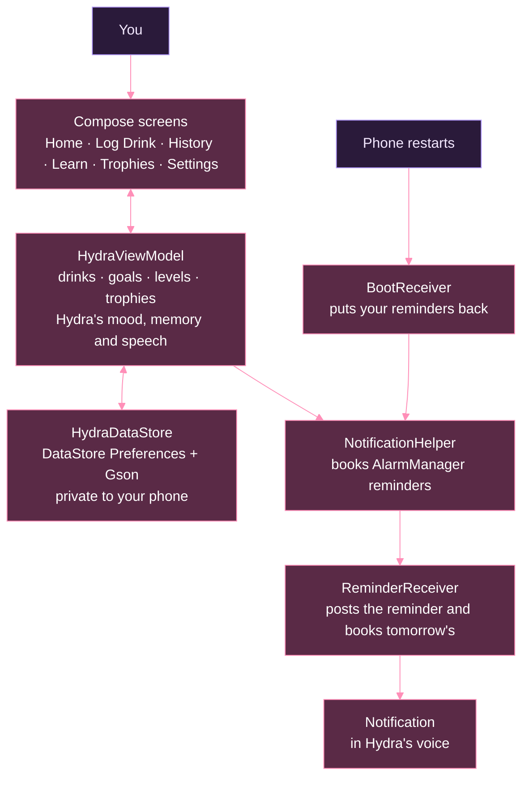

Hydra's speech isn't random. Each line comes from a section picked by what's going on (the time of
day, a limit you've gone over, your progress, your streak, what you just logged, what she remembers
about your week) in the voice of your personality, and she moves on to a new line every time you
log a drink.

# How I build HydraHeart

I build HydraHeart in Android Studio and run it on my own phone, which is the real test. If a
reminder lands at a silly time or a number looks off, I'm the first to notice.

**Tech stack:** Kotlin 2.2.10 and Jetpack Compose (BOM 2024.12.01, Material 3 1.3.1), with
DataStore Preferences and Gson for storage, Lifecycle, Core SplashScreen and downloadable Google
Fonts. minSdk 26, targetSdk 36. Every library is AndroidX apart from Gson, and none of them talk
to a server.

```bash
./gradlew :hydraheart2:assembleDebug
```

That builds the APK into `hydraheart2/build/outputs/apk/debug/`, and `installDebug` puts it
straight onto your phone.

## Project layout

| Folder | What it is |
| --- | --- |
| `hydraheart2/` | The HydraHeart app (`com.hydraheart2.app`) |
| `app/` | An earlier version of HydraHeart with a navy theme and serif fonts, kept for reference |
| `branding/` | App icon artwork |
| `docs/` | The pictures in this README |

Inside `hydraheart2/src/main/java/com/hydraheart2/app/`:

- `data/` drinks, themes, trophies, Learn topics and the data models
- `viewmodel/` the app state, goals, levels, trophies and everything Hydra says
- `ui/screens/` Home, Log Drink, History, Diary, Mood, Learn, Trophies, Settings, About and onboarding
- `ui/components/` Hydra's heart, the frosted glass cards, speech bubbles, buttons, the time picker and the nav bar
- `util/` storage, reminders, haptics, languages and the goal maths

# Feedback

Found a bug or got an idea? [Open an issue](https://github.com/iri-dev/HydraHeart/issues/new). A
screenshot and what Hydra was doing at the time help the most. I'd much rather hear about it than
not 💕

# Licence & credits

Copyright (C) 2026 iri. HydraHeart is a private project. It isn't open source and isn't licensed
for redistribution.

The fonts are Playfair Display and DM Sans from Google Fonts (SIL Open Font License). HydraHeart is
built with Jetpack Compose and AndroidX, plus Gson (both Apache License 2.0). The emoji are your
phone's own.
